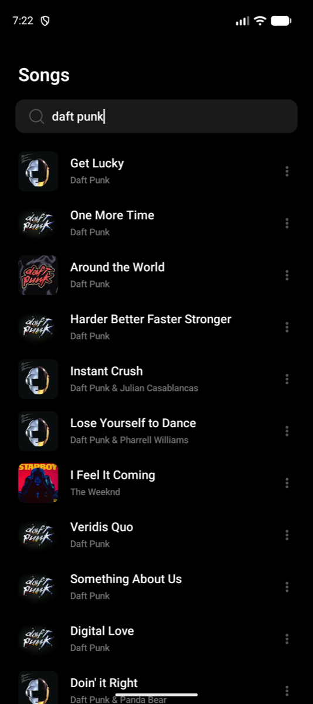
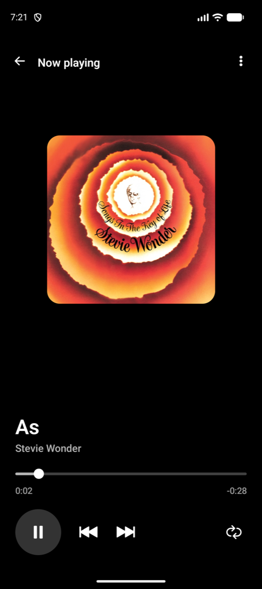
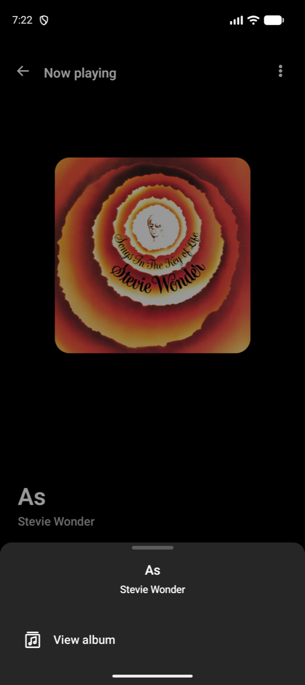
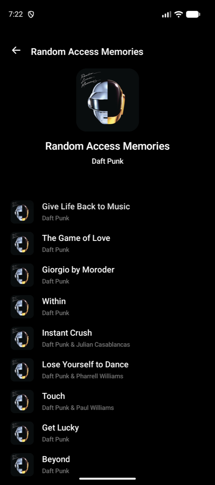
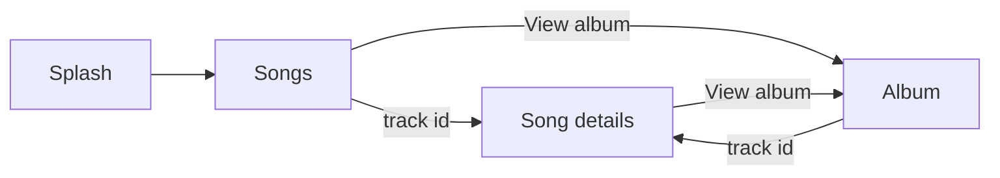
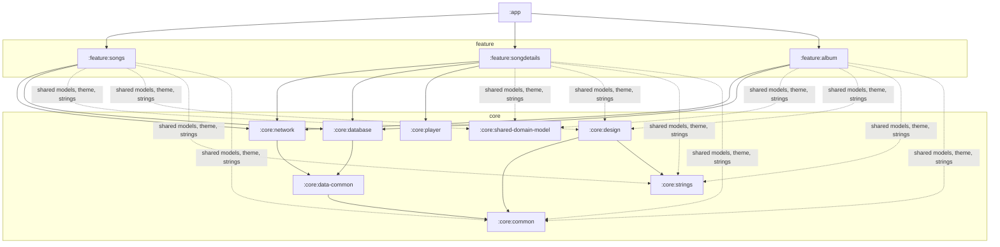
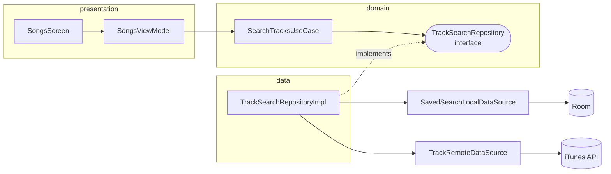
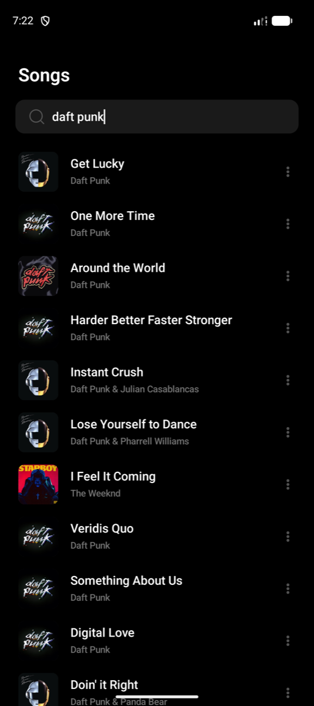

# Moisesai Challange

An Android app that searches songs through the Apple iTunes Search API, plays their previews, and keeps working offline. It is a code challenge, so it weighs **how** it is built (architecture, modularization, tests) as much as what it does.


## Contents

[App flow](#app-flow) · [Features](#features) · [Architecture](#architecture) · [Clean Architecture](#clean-architecture-in-practice) · [Offline](#works-offline) · [Technologies](#technologies) · [Testing](#testing-strategy) · [`@FullPreview`](#fullpreview) · [Claude Code](#claude-code-setup) · [Run it](#run-it) · [Limitations](#known-limitations)

## App flow

<table>
  <tr>
    <td align="center"><br><b>1. Splash</b></td>
    <td align="center"><br><b>2. Songs</b><br>search and recents</td>
    <td align="center"><br><b>3. Song details</b><br>the player</td>
    <td align="center"><br><b>4. More options</b></td>
    <td align="center"><br><b>5. Album</b></td>
  </tr>
</table>



A single-activity app: `:app` owns the navigation. Features never know each other: a route carries an id and nothing else.

## Features

| Screen | What it does |
| --- | --- |
| **Songs** | Search with pagination and pull to refresh. Shows the songs you played recently and suggestions on first launch |
| **Song details** (player) | Play and pause, seek, previous and next, queue from the album, cover that flies in from the list |
| **More options** | Bottom sheet you can pull down. "View album" opens the album |
| **Album** | Cover, artist and the track list. A track opens the player |
| **Everywhere** | Shimmer skeletons while loading, error with retry, dark theme from the Figma tokens |

## Architecture

When designing an architecture, I usually consider 3 main approaches to modularization: by feature, by layer, and a hybrid approach, where the presentation layer is divided by feature, while the domain and data layers are divided by layer. There's no right or wrong approach. It's all about trade-offs and choosing what works best for the specific project.

For this specific project, I chose feature-based modularization because I understand that the company is moving towards creating reusable libraries that can be integrated into other projects. Having worked with libraries before, I know how important loose coupling and module independence are in this scenario. This approach also allows multiple developers to work on different features in parallel with minimal interference, while making modules easier to maintain, test, and reuse across projects.

The app is **single-activity**: one `MainActivity` hosts every screen as a Compose destination, and `:app` owns the navigation.

### Modules by feature, layers as packages

Each feature owns its presentation, domain and data. Shared code lives in `core:*`.

| Approach | Good | Costs |
| --- | --- | --- |
| By feature (**chosen**) | Independent modules, easy parallel work between multiple developers, easy to extract as a library | Shared code needs a `core` module |
| By layer | Layers enforced by Gradle, faster pace because existing code is reused | Every feature change touches 3 modules, more coupled |
| Hybrid (presentation by feature, domain and data by layer) | Almost as fast as by layer, and the architecture of a feature is easy to change if the app grows and needs to be divided by feature | More modules and wiring |



Solid arrows are `build.gradle.kts` dependencies. The dotted arrow is what every feature gets from its convention plugin.

### What each module is for

| Module | Goal |
| --- | --- |
| `:app` | Starts the app, hosts navigation and dependency injection, shows the splash. The only place where features meet |
| `:feature:songs` | Search, pagination, recents, suggestions, the more-options sheet |
| `:feature:songdetails` | The player screen: play, seek, skip, queue |
| `:feature:album` | Album header and track list |
| `:core:design` | Theme, colours, `@FullPreview`, shared components and animations |
| `:core:strings` | Every user-facing string. Resources only, no code |
| `:core:common` | `AppError` and `DispatcherProvider`: what every layer may use |
| `:core:data-common` | `safeCall`, `asSafeResult`, `toAppError`. Only network and database use it, so features cannot |
| `:core:shared-domain-model` | Pure Kotlin models shared by features (`TrackDomainModel`). No Android, no logic |
| `:core:network` | Retrofit client, `ItunesApi`, `Api*` DTOs, remote datasources |
| `:core:database` | Room database, `Db*` entities, DAOs, local datasources |
| `:core:player` | Playback behind a `PlayerController` interface. Plays a URL and knows nothing else |

### Rules that keep it clean

- Features never import each other. `core` never depends on a feature.
- `presentation → domain ← data`. Presentation never imports data. Domain has no Android imports.
- Gradle enforces the module rules. The layer rules rely on review and the `clean-code-review` skill.

## Clean Architecture in practice

One direction, from the screen down to the API:

```text
Compose UI → ViewModel → UseCase → Repository → DataSource → API
```

Example, searching songs. The repository **interface** sits in `domain`, so domain never knows Room or Retrofit:



| Layer | Classes | Role |
| --- | --- | --- |
| Presentation | `*Screen`, `*ViewModel`, `Ui*` models, `*Callbacks`, components | Stateless screens, state in the ViewModel, `Ui*` models for display |
| Domain | `*UseCase`, repository **interfaces**, `*DomainModel` | Business rules in pure Kotlin |
| Data | `*RepositoryImpl` (`internal`), mappers | Chooses cache or API, maps `Api*` and `Db*` to domain models |
| Datasources | `*RemoteDataSource`, `*LocalDataSource` | Concrete classes in `core`. Catch errors and return the raw response |

How the layers talk:

- A ViewModel calls use cases. The one exception is `PlayerController`, an interface from `:core:player`: a use case that only forwards a call adds a layer and nothing else.
- Errors are caught in datasources and travel up as `Result<T>`. Cancellation is rethrown. An empty result is a success.
- `suspend` by default. `Flow` only for real streams, like the recents list.
- Models change at each border: `Api*` / `Db*` → `*DomainModel` (repository) → `Ui*` (ViewModel).
- Hilt binds each interface to its implementation inside the feature.

## Works offline



The database is the source of truth. The app reads from it and goes to the network only when something is missing.

| What | Cached | Rule |
| --- | --- | --- |
| Search | up to 200 results per search text | A saved search is never fetched again until the user pulls to refresh. Pages are read from the database |
| Track | every track that was shown or opened | Read from the database first, API on a miss |
| Album | album and its tracks, in order | Fetched once, then read from the database |
| Recently played | the last tracks played | Written by the player, read by Songs |

Nothing expires and nothing is deleted. Without a connection, anything already fetched still opens; an error appears only for what was never fetched. Audio previews stream from the network, so playing a song still needs a connection.

<br clear="right">

## Technologies

| Area | Choice |
| --- | --- |
| UI | Kotlin 2.2, Jetpack Compose, Material 3, Navigation Compose, Coil 3 |
| Architecture | MVVM + Clean Architecture, modules by feature |
| Dependency injection | Hilt |
| Async | Coroutines and Flow |
| Network | Retrofit 3, OkHttp 5, kotlinx.serialization |
| Database | Room 3 |
| Player | Media3 ExoPlayer |
| Build | Gradle 9.4, AGP 9.2, version catalog, convention plugins in `build-logic` |
| Code style | ktlint (rules in `.editorconfig`) |
| Tests | JUnit 4, MockK, Turbine, coroutines-test, MockWebServer, Compose UI test |
| SDK | `minSdk` 24, `targetSdk` 36, `compileSdk` 37 |

## Testing strategy

A pyramid: many small fast tests at the bottom, few broad ones at the top.

```text
            /\            End to end    30%   whole app, fake backend and player
           /  \
          /----\          Functional    50%   one screen or component, fake data
         /      \
        /--------\        Unit         100%   one class, collaborators mocked
```

| Layer | Runs on | Covers |
| --- | --- | --- |
| Unit | JVM | Every class with logic and every branch of its public methods |
| Functional | Emulator | The screen × state matrix, components, animations, the player engine, the database migration |
| End to end | Emulator | User journeys: cold start, search and play, album path, offline, search edge cases |

- Names read `GIVEN a saved search, WHEN searching again, THEN the network is not called`, and the body follows the same 3 parts.
- Fixtures are real API responses. The tests fail when the code is broken.
- Coverage is a rule, not a tool: the percentage is of what must be tested, and a test lands in the same commit as its code.

Details in [`ARCHITECTURE.md`](ARCHITECTURE.md) section 9.

## `@FullPreview`

One annotation, 5 Android Studio previews: phone, phone dark, small phone (320 dp), tablet and tablet dark. Every screen and component has one, so a layout problem shows up before the app runs.

```kotlin
@Preview(name = "Phone - Default")
@Preview(name = "Phone - Dark Mode", uiMode = AndroidUiModes.UI_MODE_NIGHT_YES)
@Preview(name = "Phone - Small", widthDp = 320, uiMode = AndroidUiModes.UI_MODE_NIGHT_NO)
@Preview(name = "Tablet - Default", device = Devices.PIXEL_TABLET)
@Preview(name = "Tablet - Dark Mode", device = Devices.PIXEL_TABLET, uiMode = AndroidUiModes.UI_MODE_NIGHT_YES)
annotation class FullPreview
```

```kotlin
@FullPreview
@Composable
private fun ActionSheetItemPreview() = PreviewSurface {
    ActionSheetItemComponent(iconRes = DesignR.drawable.ic_setlist, text = "View album", onClick = {})
}
```

It lives in `:core:design`, in `preview/FullPreview.kt`.

## Claude Code setup

The project was built with Claude Code, guided by files in the repository so every session starts with the same rules.

| File | Purpose |
| --- | --- |
| [`CLAUDE.md`](CLAUDE.md) | Short rule list read at every session: layering, naming, tests, working agreements |
| [`ARCHITECTURE.md`](ARCHITECTURE.md) | The full rules. If the two disagree, this one wins |
| `.claude/skills/` | Step by step procedures Claude follows for recurring tasks |
| `.claude/settings.json` + `.claude/hooks/` | A `Stop` hook that runs ktlint when Claude finishes |

| Skill | Use it to |
| --- | --- |
| `create-feature-module` | Scaffold a `:feature:<name>` module |
| `create-compose-screen` | Add a screen: state, ViewModel, navigation, previews |
| `create-ui-component` | Add a reusable component with `@FullPreview` |
| `create-animation` | Add motion with the project's phase timeline |
| `add-data-endpoint` | Take an endpoint through DTO, datasource, repository and use case |
| `write-unit-tests` | Write Given / When / Then unit tests from real fixtures |
| `write-ui-tests` | Write functional and end-to-end tests |
| `clean-code-review` | Review code against Clean Code and these conventions |

**Hook.** When Claude finishes, `.claude/hooks/ktlint-check.sh` runs `./gradlew ktlintCheck`, only if a Kotlin file changed. On violations it hands them back to Claude, which runs `ktlintFormat`, fixes the rest and stops again. A second stop never re-runs it, so it cannot loop.

Working agreements: plan first, small steps, one test per behaviour in the same commit, and `clean-code-review` as the last check.

## Run it

### Requirements

- Android Studio with the Android SDK **37** installed
- JDK 21. The Gradle daemon is pinned to 21 and downloads it automatically if it is missing
- An emulator or device running Android 7.0 (API 24) or newer, to run the app and the instrumented tests

### Run

Open the project in Android Studio and run the `app` configuration, or from a terminal:

```bash
./gradlew installDebug
```

### Test and verify

```bash
./gradlew testDebugUnitTest            # unit tests, all modules
./gradlew lintDebug                    # Android lint, all modules
./gradlew ktlintCheck                  # code style, all modules (ktlintFormat fixes it)
./gradlew connectedDebugAndroidTest    # instrumented tests (needs a running emulator or device)
./gradlew clean assembleDebug testDebugUnitTest lintDebug ktlintCheck   # the full local check
```

The Gradle wrapper is the only supported way to build. Gradle 9.4.1 is downloaded on first use.

### Continuous integration

Every pull request against `master` runs [`.github/workflows/ci.yml`](.github/workflows/ci.yml) on GitHub Actions (JDK 21): unit tests, Android lint and ktlint. Reports are uploaded when it fails.

A failing run shows as a red check on the pull request, but it does **not block the merge**: branch protection is not enabled yet. It is a setting that takes a minute on the GitHub website (Settings → Branches → require the "Unit tests, lint and ktlint" status check on `master`).

```bash
./gradlew testDebugUnitTest lintDebug ktlintCheck --continue   # the same command, locally
```

### Code style (ktlint)

Every module is checked with [ktlint](https://pinterest.github.io/ktlint/) 1.8.0, through the `org.jlleitschuh.gradle.ktlint` plugin applied once in the root `build.gradle.kts`.

```bash
./gradlew ktlintFormat   # fixes what it can
./gradlew ktlintCheck    # fails on what is left
```

- Rules live in [`.editorconfig`](.editorconfig): the `android_studio` style, 4 spaces, 140 characters per line.
- Exceptions, each commented in the file: the `view_model` package, underscore names in instrumented tests, `@Composable` function names, long backticked test names.
- `ktlintCheck` is part of the full local check above.

## Known limitations

- The Articulat CF font is commercial, so the app uses the system font.
- The tablet, watch and Android Auto frames of the design are not built.
- CI runs only the checks that need no emulator. The instrumented and end-to-end tests run locally.
