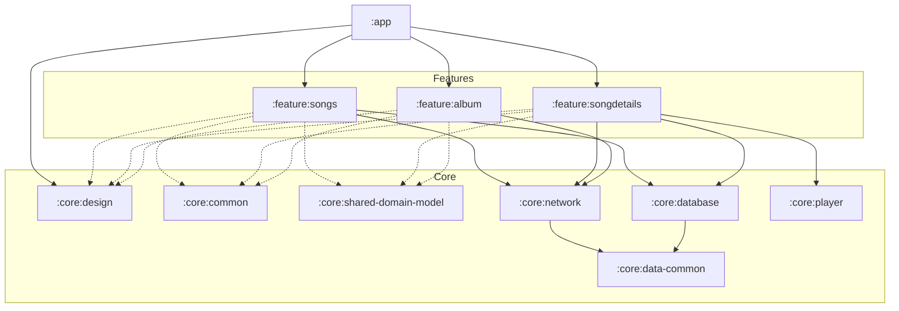

# Moisesai Challange

An Android app that searches songs through the Apple iTunes Search API, plays their previews, and keeps working offline. It is a code challenge, so this repository puts as much weight on **how** it is built (architecture, modularization, tests) as on what it does.

> **Work in progress.** The project foundation is complete: modules, build setup, dependency injection and test tooling. The features are being built on top of it step by step. The [Status](#status) section says exactly what exists today.

## Table of contents

- [Status](#status)
- [Getting started](#getting-started)
- [Architecture](#architecture)
- [Tech stack](#tech-stack)
- [Repository layout](#repository-layout)
- [Conventions and further reading](#conventions-and-further-reading)
- [Decisions and trade-offs](#decisions-and-trade-offs)
- [Known limitations](#known-limitations)
- [Possible improvements](#possible-improvements)

## Status

**Challenge requirements**

| Requirement | State |
| --- | --- |
| Kotlin, Jetpack Compose, coroutines | Set up |
| MVVM with clean-architecture layering | Conventions defined and documented; first feature pending |
| Modularization | Done: 3 feature modules, 6 core modules |
| Tests | Tooling ready (JUnit, MockK, coroutines-test, Turbine, MockWebServer); first real tests arrive with the data layers |
| Network abstraction layer | Done: `:core:network` (Retrofit, OkHttp, kotlinx.serialization) with concrete `TrackRemoteDataSource` and `AlbumRemoteDataSource` (the replaceable boundary is the repository interface in each feature's domain), tested against live-captured JSON |
| Offline-first cache, recently played on home | Database layer done: `:core:database` (Room 3) caches searches with page reads and stores recent tracks, tested on a device; the repositories that use it come with the songs feature |
| API pagination | Pending |
| Splash, Songs, Song details (player), More-options sheet, Album | Pending |

**Foundation (done)**

- [x] Version catalog and `build-logic` convention plugins
- [x] `:core:common`, `:core:data-common`, `:core:design` (theme, `@FullPreview`), and empty core, library and feature modules
- [x] Hilt in `:app`
- [x] Test tooling wired into every module
- [x] Architecture documentation and contributor conventions
- [x] Data layers: `:core:network`, `:core:database` and the shared `TrackDomainModel` in `:core:shared-domain-model`

This table is updated as each feature lands.

## Getting started

### Requirements

- Android Studio with the Android SDK **37** installed
- JDK 21. The Gradle daemon is pinned to 21 and downloads it automatically if it is missing
- An emulator or device running Android 7.0 (API 24) or newer, to run the app and the instrumented tests

### Run

Open the project in Android Studio and run the `app` configuration, or from a terminal:

```bash
./gradlew installDebug
```

### Test and verify

```bash
./gradlew testDebugUnitTest            # unit tests, all modules
./gradlew lintDebug                    # Android lint, all modules
./gradlew connectedDebugAndroidTest    # instrumented tests (needs a running emulator or device)
./gradlew clean assembleDebug testDebugUnitTest lintDebug   # the full local check
```

The Gradle wrapper is the only supported way to build. Gradle 9.4.1 is downloaded on first use.

## Architecture

### Layers

Each feature follows one direction of dependencies, from the screen down to the API:

```text
Compose UI -> ViewModel -> UseCase -> Repository -> DataSource -> API
```

- A ViewModel talks to use cases only, never to repositories, data sources or the API.
- Failures are caught in data sources and travel upward as `Result<T>` (`Flow<Result<T>>` for streams). Coroutine cancellation is always rethrown, never turned into a failure.
- `suspend` is the default. `Flow` is used only for real streams, such as an observed database query.
- Mapping happens at the boundaries: data models become domain models in the repository, and domain models become `Ui*` models in the ViewModel. Model names carry their layer: `Ui*`, `*DomainModel`, `Api*`, `Db*`.

### Modularization: by feature, not by layer

There is no global `:domain` or `:data` module. Each feature module owns its own presentation, domain and data as packages. Modules shared by several features hold infrastructure and shared models only, with no feature logic.



Solid arrows are the explicit module dependencies. Dotted arrows are the shared core modules every feature gets from its build plugin.

| Module | Responsibility |
| --- | --- |
| `:app` | Application, MainActivity, navigation host, dependency-injection root, splash. The only place where features meet |
| `:feature:songs` | Search, pagination, recently played list, More-options sheet |
| `:feature:songdetails` | Song details screen with the player: play/pause, seek, timeline, skip |
| `:feature:album` | Album header and track list |
| `:core:design` | Theme, `@FullPreview`, shared UI components |
| `:core:common` | `AppError` and the dispatcher provider: what every layer may use |
| `:core:data-common` | `safeCall`, `asSafeResult`, `toAppError`: error handling for datasources. Only `:core:network` and `:core:database` depend on it |
| `:core:shared-domain-model` | Pure Kotlin shared domain models (`*DomainModel`). A JVM module, so Android imports do not compile there |
| `:core:network` | HTTP client setup, the API service and DTOs, the remote data source behind an interface |
| `:core:database` | The Room 3 database, entities, DAOs and local datasources |
| `:core:player` | Reusable playback engine behind a `PlayerController` interface. It knows nothing about the app |

### Dependency rules

- Features never depend on or import each other. They are connected by routes and callbacks in `:app`, and routes carry ids only.
- `core` modules never depend on a feature.
- Inside a feature the direction is `presentation -> domain <- data`. Presentation never imports data, and domain has no Android imports.

Because layers are packages, Gradle cannot enforce the last rule. An architecture test for it is planned.

### Inside a feature

```text
com.moisesai.challange.feature.<name>
├── presentation/   composable/  model/  view_model/  navigation/  mapper/
├── domain/         usecase/  repository/   (interfaces)
└── data/           datasource/  repository/  mapper/
```

Folders are created with their first file, so a feature only shows the packages it uses.

## Tech stack

| Area | Choice |
| --- | --- |
| Language and UI | Kotlin 2.2, Jetpack Compose with Material 3 |
| Dependency injection | Hilt, with KSP |
| Concurrency | Kotlin coroutines and Flow |
| Build | Gradle 9.4 with the Android Gradle Plugin 9.2, a version catalog, and `build-logic` convention plugins |
| SDK | `minSdk` 24, `targetSdk` 36, `compileSdk` 37 |
| Testing | JUnit 4, MockK, `kotlinx-coroutines-test`, Turbine, MockWebServer |

Networking: Retrofit, OkHttp and kotlinx.serialization in `:core:network`. Persistence: Room 3 with the AndroidX SQLite framework driver in `:core:database`. Playback libraries are added with the module that uses them.

## Repository layout

```text
app/                 the application module
feature/             songs, songdetails, album
core/                design, common, shared-domain-model, network, database, player
build-logic/         convention plugins shared by every module
gradle/              wrapper and the version catalog (libs.versions.toml)
ARCHITECTURE.md      the full architecture reference
CLAUDE.md            short contributor and AI-assistant conventions
.claude/skills/      step-by-step procedures for scaffolding features, screens and data, and for reviewing against Clean Code
```

## Conventions and further reading

- [`ARCHITECTURE.md`](ARCHITECTURE.md) is the complete reference: layering, `suspend` versus `Flow`, error handling, naming, theming and testing.
- [`CLAUDE.md`](CLAUDE.md) is the short rule list that new code follows.
- `.claude/skills/` holds the procedures for adding a feature module, a screen, a shared UI component a data endpoint, unit tests (Given / When / Then), and a Clean Code review.

## Decisions and trade-offs

Each entry says what was chosen, why, and what it costs. New entries are added in the same change that introduces the decision.

### Modules by feature, not by layer

- **Why:** a feature can be read, tested and changed on its own, and the dependency rules are visible in the build files.
- **Trade-off:** several small modules mean more build files. Layers inside a feature are packages, so Gradle does not enforce the layer rules. An architecture test is planned for that.

### Error handling for datasources in its own module

- **Why:** the remote and local datasources wrapped calls in the same way. One module holds `safeCall`, `asSafeResult` and `toAppError`, and only the data modules depend on it, so Gradle stops a repository or a feature from catching errors itself.
- **Trade-off:** one more small module. `AppError` and `DispatcherProvider` stay in `:core:common` because every layer uses them.

### A thin `core`

- **Why:** the three features share the song models, the iTunes client and one Room database. Without a shared layer they would import each other or duplicate code.
- **Trade-off:** `core` can turn into a dumping ground. The rule is infrastructure and shared models only, never feature logic.

### Datasources are concrete classes; the repository interface is the replaceable boundary

- **Why:** a datasource wraps one source that is already an abstraction (the Retrofit service, a Room DAO), so an interface on top adds a file without adding a seam. Clean Architecture puts the seam where the domain meets the data layer: the repository interface. Replacing the API means rewriting the datasources, the `Api*` models and the mappers; the domain, ViewModels and UI do not change.
- **Trade-off:** the replaceable boundary is one layer higher than a datasource interface would make it, and the `Api*` models are iTunes-shaped. Tests fake the layer below (MockWebServer, in-memory Room) or mock the concrete class with MockK.

### Datasources return the raw response; the repository mapper reads it

- **Why:** a datasource that filters or assembles (`.tracks()`, `firstOrNull()`, a custom aggregate type) is doing a mapper's job and invents a type the API never sent. Returning `Result<ApiResponse>` keeps it a one-line call, and the mapper reads mixed responses with the shared extensions `ApiResponse.tracks()` and `album()`.
- **Trade-off:** knowledge of the response envelope (a lookup returns the album, then its tracks) sits in the feature repositories instead of the network module.

### DTO nullability comes from real data

- **Why:** each field was checked against 3,455 real tracks and 8 albums. Fields always present are non-null, so the mappers need no null checks. Only `artworkUrl100`, `previewUrl` and `releaseDate` are nullable, because the docs or the data show they can be absent. DTOs also have no default values: `explicitNulls = false` already reads an absent nullable field as `null`.
- **Trade-off:** a non-null field missing from one item fails the whole response as `AppError.Unknown`. That is deliberate (a malformed response should be loud), but one odd item would turn a search into an error.

### Room 3, not Room 2

- **Why:** Room 3 (`androidx.room3`, stable) is the current generation: coroutine-first (every DAO function is `suspend` or a `Flow`), driver-based, Kotlin and KSP only. Starting a new database on Room 2 would mean migrating it later.
- **Trade-off:** it is newer, so there is less community material than for Room 2, and its transaction API differs (`withWriteTransaction`). I checked the APIs I use against the published artifacts.

### Room tests are instrumented, with underscore names

- **Why:** the tests run on the device's real SQLite with an in-memory database. DEX before version 40 forbids spaces in method names and `minSdk` is 24, so these tests keep the uppercase `GIVEN`, `WHEN` and `THEN` and join the words with underscores. JVM tests keep the sentence form.
- **Trade-off:** they need an emulator or device (`connectedDebugAndroidTest`) and run slower than JVM tests; the naming differs between the two kinds of test.

### Datasources do not switch dispatchers

- **Why:** Retrofit and Room suspend calls are main-safe, so a `withContext` in the datasource only adds noise. The repository injects a `DispatcherProvider` and switches only for blocking or CPU-heavy work.
- **Trade-off:** the rule is easy to forget in a new datasource that wraps genuinely blocking code.

### Convention plugins in `build-logic`

- **Why:** with ten modules, repeating the SDK, Java, Compose and test setup in each build file is error-prone. One plugin per kind of module keeps them identical.
- **Trade-off:** an extra included build to understand. It is the same pattern Google's Now in Android sample uses.

### `:core:shared-domain-model` is a JVM-only module

- **Why:** without Android on its classpath, the compiler itself rejects Android imports in the shared models.
- **Trade-off:** one more convention plugin to maintain.

### Instrumented tests are enabled only where they exist

- **Why:** Hilt generates test sources in every module that uses it, which gave empty modules a test APK that crashed on launch. The library plugin now enables the `androidTest` variant only for modules with a `src/androidTest` folder.
- **Trade-off:** a module that adds instrumented tests later also needs the test-runner dependency.

### `compileSdk` 37

- **Why:** the current AndroidX versions used here require it. `targetSdk` stays at 36, so runtime behaviour and supported devices do not change.

### No placeholder tests

- **Why:** the test tooling was proven with temporary tests that were removed afterwards. A test that only checks a constant adds noise, not safety.
- **Trade-off:** the first real tests land with the data layers.

## Known limitations

- The app does not yet implement the challenge screens. `MainActivity` still shows the template greeting.
- The module dependency rules are enforced by convention and review, not by a failing build.

## Possible improvements

Collected here as the work progresses.
